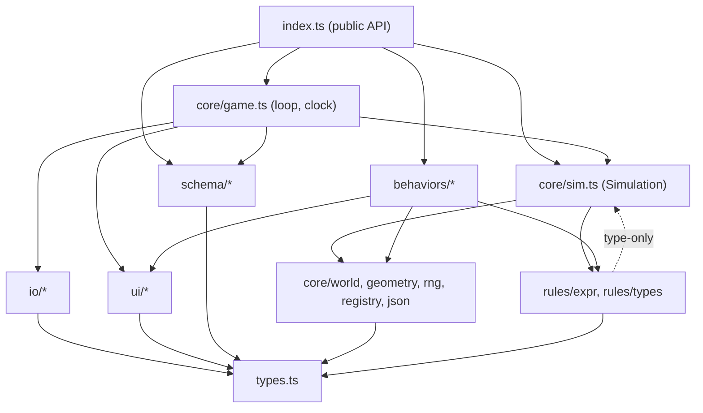
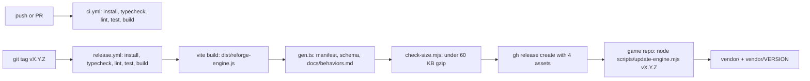

# Design: engine-core

> Written from the shipped v0.1.0 code (`engine/src/**`), not before it. Requirement numbers refer to `requirements.md`.

## 1. Module map

All files live under `engine/src/`. Every module may import `types.ts`, which imports nothing.

| Module       | Files                                                                | Role                                                                                                                                                           |
| ------------ | -------------------------------------------------------------------- | -------------------------------------------------------------------------------------------------------------------------------------------------------------- |
| `types.ts`   | one file                                                             | Shared types: `Json`, `Entity`, `InputFrame`, `Param`, `RenderState`, the `AssetStore`, `Renderer`, `InputSource`, `UiHost` contracts.                          |
| `core/`      | `sim`, `world`, `geometry`, `rng`, `registry`, `json`, `game`        | The simulation (pure of DOM and clock), the entity store, AABB math, the PRNG, the registry class, and `game.ts`, the only file that reads the clock.          |
| `rules/`     | `expr`, `types`                                                      | `$` reference resolution, `{name}` interpolation, target matching, and the `EventDef`/`ConditionDef`/`ActionDef` interfaces.                                   |
| `behaviors/` | `events`, `conditions`, `actions`, `components`, `util`, `index`     | Data tables of definitions. `index.ts` builds a `Registry` from them plus `widgetDefs`.                                                                        |
| `ui/`        | `mount`, `widgets`, `defs`, `format`, `reforge-engine.css`           | DOM overlay. Reads a `UiHost`; never imports the simulation.                                                                                                   |
| `io/`        | `assets`, `input`, `renderer`, `draw`, `transform`                   | Impure edges: image loading, DOM events, Canvas 2D drawing, screen/world transform.                                                                            |
| `schema/`    | `types`, `validate`, `jsonschema`, `shared`                          | `GameJson` types, `validateGame`, JSON Schema, and the required-key lists both share.                                                                          |
| `index.ts`   |                                                                      | Public surface: `createGame`, `createSimulation`, `validateGame`, `registry`, `gameSchema`, `version`.                                                         |
| `scripts/`   | `gen.ts`, `check-size.mjs` (in `engine/scripts`)                     | Build-time generators and the size gate.                                                                                                                       |

### Diagram 1: module dependencies (from the real imports)



The only cycle is type-only (`rules/types` imports the `Simulation` type from `core/sim`). It disappears at runtime.

## 2. Data flow: game.json to pixels

1. `createGame(json, canvas, opts)` calls `validateGame(json)`. Invalid: return the inert Game (R1.12).
2. Valid: `new Simulation(json, { registry, seed })`. The constructor copies `meta`, `entityTypes`, `scenes`, `rules`, `ui` and `tables`, then `reset()`:
   - `Rng(seed)`, variables from `json.variables`, UI panels with `hidden !== true` opened.
   - `loadScene(meta.startScene)`: for each instance, `spawnInstance` merges type and instance (R5.2), fills component defaults from the registry, puts extra keys into `props`, and calls `World.add`.
   - Queue `start`.
3. `createAssetStore`, `createRenderer`, `createInput` and `mountUi` are created around the canvas. `start()` preloads `sim.assetPaths()`, then starts `requestAnimationFrame`.
4. Each frame: clamp the elapsed time, run up to 5 ticks (`sim.step(input)`), then `renderer.draw(sim.renderState())` and `ui.update()`.
5. `renderState()` is a read-only view: scene size, the camera view rectangle (R7), the live entities, an id map, the background.

The renderer and UI never write to the simulation. The only path from the screen back into it is `InputFrame` (canvas events) and `host.click(id)` (buttons), both of which queue events.

### Diagram 2: one tick

```mermaid
sequenceDiagram
  participant L as Loop (game.ts)
  participant S as Simulation.step
  participant Q as Event queue
  participant R as Rules (dispatch)
  participant B as Behavior (registry)
  participant W as World

  L->>S: step(inputFrame)
  S->>Q: push key pressed, released, down; clicks (hit-tested)
  alt game not ended
    S->>Q: push tick
    S->>S: advanceTimers() pushes timer events
    S->>W: runAi(), runMovers() with moveWithCollision
    S->>Q: detectCollisions() pushes collide for new pairs
  end
  loop until queue empty (max 10000)
    S->>Q: shift event
    S->>R: dispatch(event)
    R->>B: event.matches(when) returns Scope or null
    R->>B: condition.test(params resolved)
    R->>B: action.run(params resolved, scope)
    B->>W: add / mutate / flag for removal
    B->>Q: emit(varChanged, custom, died)
  end
  S->>W: flush() applies deferred removals and drops their timers
  S->>S: tick += 1
```

## 3. The registry contract

`Registry` (`core/registry.ts`) holds five `Map<string, Def>` by kind. It is the single source of truth (R16).

```ts
interface BehaviorMeta {
  name: string; label: string; params: Param[]; help?: string;
}
interface Param {
  name: string; label: string;
  type: "number" | "string" | "boolean" | "select" | "color" | "entityType"
      | "tag" | "variable" | "scene" | "asset" | "target";
  required: boolean; default?: Json; min?: number; max?: number; options?: string[]; help?: string;
}
interface EventDef extends BehaviorMeta {
  matches(when: JsonObject, ev: GameEvent, sim: Simulation): Scope | null;
}
interface ConditionDef extends BehaviorMeta { test(sim, p: JsonObject, scope: Scope): boolean }
interface ActionDef extends BehaviorMeta { run(sim, p: JsonObject, scope: Scope): void }
type ComponentDef = BehaviorMeta;   // data only; systems live in core/sim.ts
type WidgetDef = BehaviorMeta;      // rendering lives in ui/widgets.ts
interface Scope { self?: Entity; other?: Entity; timer?: JsonObject }
```

- `registerX(def)` throws on a duplicate name in the same kind.
- `list(kind)` is sorted by name. `toManifest(version)` maps each def to `{ name, label, params, help? }`.
- `componentDefaults(name)` returns the `default` of each param. `spawnInstance` merges it under the entity's own values.
- Adding a behavior is one entry in a `behaviors/*.ts` table (or `ui/defs.ts` for widgets). The manifest, schema docs, `docs/behaviors.md` and the editor's forms follow with no other change.
- Components and widgets are metadata. Their runtime lives in `Simulation` (movers, AI, health, collisions) and in `ui/widgets.ts`.

## 4. Determinism rules

- All state change happens in `Simulation.step`. It reads no clock, no `Math.random`, no DOM. ESLint bans `Math.random` and `Date.now` in `engine/src`.
- Time is `tick`. Timers store ticks (`max(1, round(seconds / DT))`).
- One `Rng` (mulberry32, uint32 state). Used by `random`, `log` with `pick`, `spawnFromTable`.
- Iteration is ordered: `Map` insertion order for entities, rules in file order, events FIFO, collision pairs sorted by id.
- Removal is deferred to `flush()`. Within one tick an entity flagged for removal is invisible to queries but still reachable by id.
- Generated entity ids come from a counter in the World (R4.2). `restart()` resets it.
- `getState()` returns plain, sorted JSON, so two runs compare with `toEqual`.
- Real time touches the simulation only through "how many ticks to run this frame", and the first tick of a frame gets the new input. The rest repeat `down` only.

## 5. Render, input and UI separation

- **io/renderer**: owns the canvas transform (`fitView`, letterbox, devicePixelRatio). `draw(state, { debug })` clears, fits the view, draws links, then entities sorted by layer, y, id.
- **io/input**: listens on the canvas and window, queues events, and `frame()` drains them into one `InputFrame`. World coordinates come from `renderer.screenToWorld`.
- **ui**: `mountUi(root, host)` builds `.rf-ui` with nine position slots. `update()` runs once per frame. It rebuilds only when `host.widgets` changes identity, otherwise it patches text, widths and visibility.
- **core/game.ts** wires the three, owns `requestAnimationFrame`, the accumulator and the visibility handler. It is the only file that calls `performance.now`.

## 6. Schema and validator pipeline

1. `schema/shared.ts` holds the required-key lists (`GAME_REQUIRED`, `META_REQUIRED`, `SCENE_REQUIRED`, `INSTANCE_REQUIRED`, `RULE_REQUIRED`) and `MAX_ERRORS`.
2. `schema/validate.ts` walks the input with `unknown` narrowing and collects `{ path, message }`. It never throws and is deterministic and sorted.
3. `schema/jsonschema.ts` builds `gameSchema` (draft 2020-12) from the same lists.
4. `scripts/gen.ts` serializes `gameSchema` to `dist/game.schema.json`.
5. Behavior names and fields are not checked here. The editor uses the manifest, and the Simulation reports unknown names at run time (R15.9).

## 7. Build and release pipeline

`pnpm -F engine build` = `vite build` (library mode, one ES file, no externals) then `vite-node scripts/gen.ts` (manifest, schema, `docs/behaviors.md`) then `scripts/check-size.mjs` (fails over 60 KB gzip; now about 21 KB). The CSS is copied from `src/ui/reforge-engine.css` by a small Vite plugin.

### Diagram 3: release pipeline



`release.yml` reaches `gh release create` only if every earlier step passes (R12.5).

## 8. Correctness properties (fast-check)

Each property is run with `fc.assert`. If one fails, the engine is fixed, not the property (see tasks.md T19 to T23).

| ID | Property | Requirements | File |
| -- | -------- | ------------ | ---- |
| P1 | **Determinism.** For a rich fixture game, a seed and a generated input script, two simulations (one from a deep copy of the JSON) have equal `getState()` after every tick, and `gameJson` is unchanged afterwards. | R2.7, R3, R5.3 | `core/sim.prop.test.ts` |
| P2 | **World ids.** For random add/remove/flush/clear sequences, generated ids are never equal to any id issued earlier, live ids are unique, and queries equal a naive filter of the model. | R4.2, R4.7 | `core/world.prop.test.ts` |
| P3 | **Pending removal.** After `remove(id)` and before `flush()`, the entity is absent from `all`, `count` and every query, and still returned by `getById`. | R4.4 | `core/world.prop.test.ts` |
| P4 | **No entry into solids.** For a random solid set, start box and step, a mover never ends overlapping a solid it did not overlap at the start. | R9.7 to R9.9 | `core/geometry.prop.test.ts` |
| P5 | **Collision symmetry.** `overlap(a, b) === overlap(b, a)`, and `collisionPairs` has no self-pairs or duplicates and is sorted. | R9.2, R9.4 | `core/geometry.prop.test.ts` |
| P6 | **Validator robustness.** Random mutations of `examples/hello/game.json` (delete a key, replace a value with another type) never throw, return a consistent `{ ok, errors }`, and report pointer-style paths. Deleting a required key reports exactly that path. | R10.4, R10.5 | `schema/mutation.prop.test.ts` |
| P7 | **Manifest and docs.** Every registry entry of every kind appears in `toManifest()` with equal params, names are sorted and unique, and the committed `docs/behaviors.md` equals what the generator renders now. | R16.6 to R16.8 | `behaviors/manifest.prop.test.ts` |
| P8 | **Existing.** `validateGame` accepts generated valid games, round-trips, and never throws on `fc.anything()`. | R10 | `schema/validate.prop.test.ts` |

## 9. Known deviations

Places where the original requirements, the team brief or the steering docs disagreed with the code. The requirements and this design now follow the code except where marked **open**.

1. **Draw order. Open.** The brief says draw order is array order with an optional `layer`. `io/draw.ts` `sortForDraw` sorts by layer, then `y`, then id, and a renderer test pins that. Array order is not used. This matters for the editor's "Bring front" and "Send back", which reorder the array. Needs a decision (tasks.md T16).
2. **Entity ids.** The original draft said `e1`, `e2`. The code uses `<type>-<n>` for generated ids and the authored `id` when given.
3. **Removal visibility.** The draft said a removed entity stays queryable until the end of the tick. The code hides it from queries immediately and keeps `getById`. Adds are visible immediately, not at end of tick.
4. **Tick order.** The draft listed input, movers, collisions, flush. The shipped order also runs timers, AI and rules, and rules run after collisions (R2.9).
5. **Pause on hidden tab.** The draft said "pause". The code resets the clock when the tab becomes visible again and relies on the browser suspending `requestAnimationFrame`.
6. **`setScene` timing.** The draft said "after the current tick". `setScene` and `changeScene` apply immediately.
7. **`createSimulation`.** The draft did not say it throws. It throws on invalid games. `createGame` never throws.
8. **Module dependencies.** `structure.md` said `ui` and `io` depend on `core`, and `schema` and `core` depend on nothing. Actually `ui`, `io` and `schema` depend only on `types.ts`. `core/game.ts` depends on `io`, `ui` and `schema`. `behaviors/index.ts` depends on `ui` for the widget definitions.
9. **Lint scope.** `pnpm -r lint` finds no script. Lint is defined at the repo root (`pnpm lint`) and covers `engine/src` only.
10. **CI and release Node versions.** `ci.yml` uses Node 20 and `release.yml` uses Node 22.
11. **`kind` on instances.** It is stored in `props` and not drawn (R8.9).
12. **Collision exit.** The Simulation tracks pairs between ticks but emits no exit event. Only `collide` on entering.
